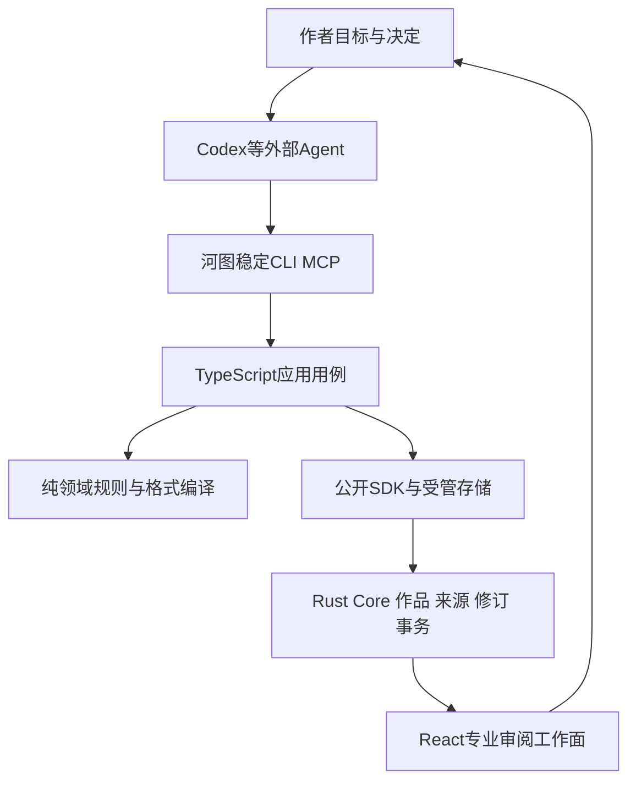
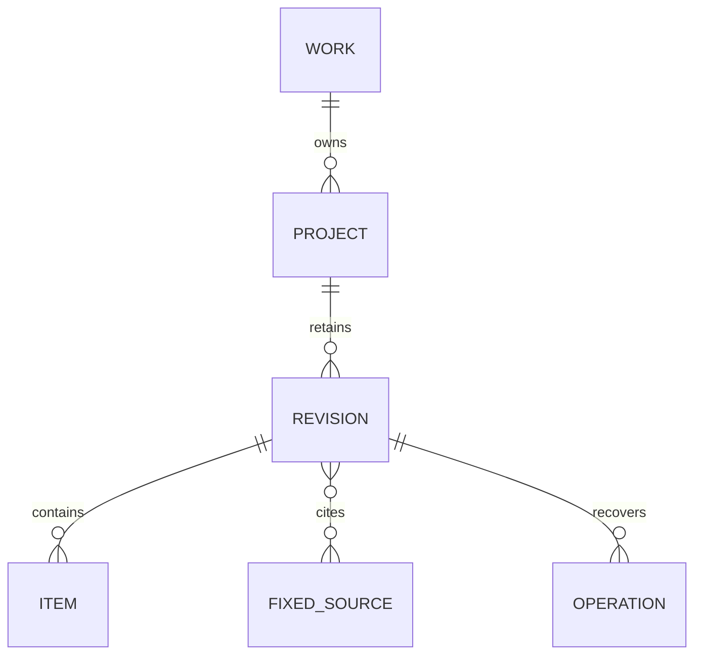
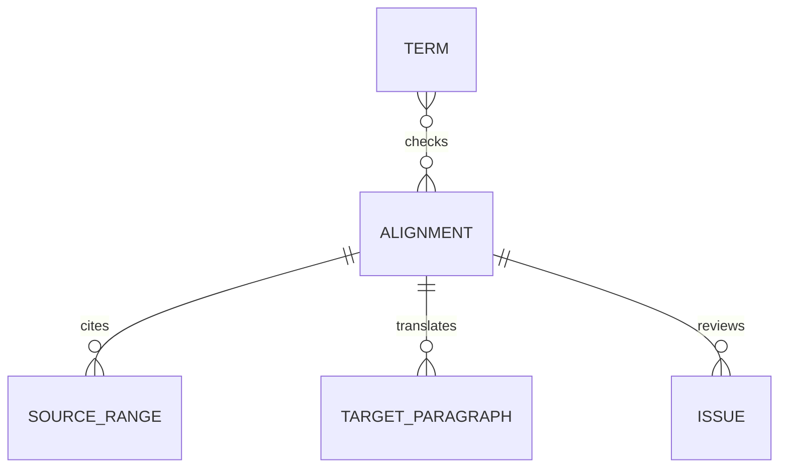

> 本文属于[译稿工坊文档](README.md)。

# 架构与领域设计

专业聚合包括：源文选区、对齐组、译文段落、术语、问题、译稿修订。宿主是作品身份、正文、设定、素材、固定修订和事务的唯一 Owner；本插件是专业聚合的 Owner。公共 SDK 为依赖边界，Cordis 生命周期留在宿主，不依赖其私有服务或 DSH 原包。

专业数据采用一个受管根对象与有稳定 ID 的子记录。Core 保存不可变修订链、对象摘要、固定来源及原操作结果；本包不建数据库服务。读取与导出固定修订，更新使用 CAS。专业编译与解析无网络、无模型调用。

WorkRef 是隔离边界。同名作品和同名实体不能合并；专业来源只追加。跨插件依据读取确切 Owner、对象、修订与摘要，跨作品引用不等于读取或修改权。

## 专业关系

子记录在同一个专业聚合中原子保存，不建跨数据库外键。固定来源与专业依据以宿主不可变引用关联；专业关系的增删须通过本包应用用例重验完整聚合。查询索引、CAS、修订及操作恢复复用Core，不维护第二份正文或可漂移的副本。
