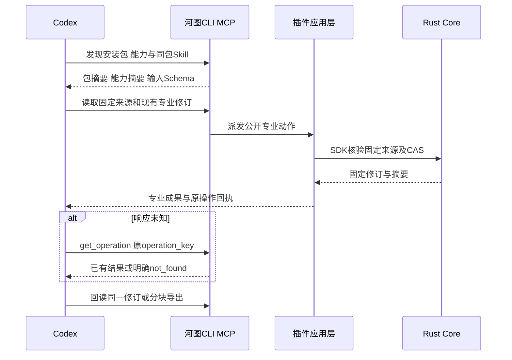

> 本文属于[译稿工坊文档](README.md)。

# 数据与API设计

格式版本 `format_version: 1`。公共字段为 title、basis_refs；对象身份、schema_version、source_refs、revision 和 sha256 由 Core 保存。专业字段与全部动作的输入 Schema 以 [manifest](../contracts/plugin-manifest.json) 为唯一机器合同，构建生成 [操作地图](../skills/hetu-story-translation/references/operations.md)。

新建使用 expected_revision=0、expected_sha256 为空；更新携带固定对象、修订、摘要与 operation_key。旧来源索引不可重定向。每个专业写动作先核验领域引用、输入预算和固定来源，再用公开 SDK 原子提交。

list_projects/get_project/save_project、单项 put/remove、get_source/get_basis、compare_versions、export_project、create_handoff/get_operation 构成共同操作形态。格式解析、路线执行、译稿检查、声音探测和书稿编译由各自专业只读动作承担；只读动作不修改正式内容。

导出返回完整文件摘要、分块摘要、总字节及下一偏移。文本必须在 UTF-8 边界分块；二进制通过 Base64 分块并核验原字节。调用方沿固定修订重组，不混入新版字节。费用、授权引用及本机私密路径不进入专业导出。

## 专业数据合同

alignments中的source_ranges引用固定正文的UTF-8字节区间及quote，targets允许多段。scope_indices定义实际阅读范围。terms区分preferred/required/forbidden。issues绑定alignment_id与target_sha256，不能把旧意见坐标自动搬到新版。

| 聚合字段 | 子记录字段（约束以manifest为准） |
| --- | --- |
| `alignments` | `id`, `title`, `source_ranges`, `targets`, `status` |
| `terms` | `id`, `source`, `target`, `mode`, `case_sensitive`, `note` |
| `issues` | `id`, `title`, `alignment_id`, `target_sha256`, `comment`, `status`, `resolution`, `recheck_sha256` |
| `source_language` |  |
| `target_language` |  |
| `scope_indices` |  |

所有专业更新对完整聚合重新校验；删除仍被引用的记录会失败，不能留下悬空引用。固定专业依据由 `owner_plugin_id/object_id/revision/sha256` 唯一确定。宿主来源最多64项，超过时应按创作范围拆分专业对象，不覆盖旧索引。

## 调用与恢复

`get_operation` 为已有写入结果回读；未知时先读，明确不存在才用原输入与原键恢复。`revision_conflict` 表示当前基线已变化，保留输入并读取新版本，合并后以新的明确操作提交。同键异参拒绝。Schema非法、引用不存在、摘要不一致与预算超限均在提交前失败；只读专业检查不产生正文采纳或作者决定。
