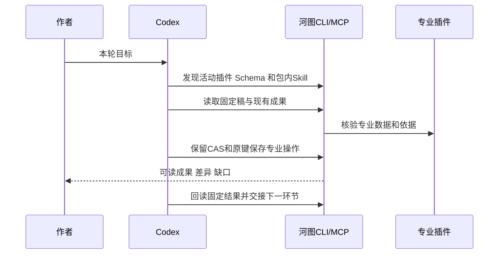

> 本文属于[译稿工坊文档](README.md)。

# Skill与机器协作

包内 `hetu-story-translation` 由河图注册，Codex 使用稳定 invoke 的 skills.read 读取，不安装同名Codex插件。实际旅程为：固定源文 → 一对多或多对一对齐 → 外部Agent提交译稿 → 术语检查与意见 → 局部返工 → 源文更新影响分析 → HTML／XLIFF交付。

先发现当前包、作品与精确 management_ref，再读固定修订和现有成果。来源不明保持未知，外部引用不扩大范围。专业方法由Skill指导，参数始终查实际Schema；升级或停用后重新发现。未知结果沿原键回读。

生成与语义判断仍由外部Agent完成。专业交接包含固定对象和来源，下游保存自己的专业状态或宿主候选；正文采纳、定稿、内容外发与费用分别决定。
